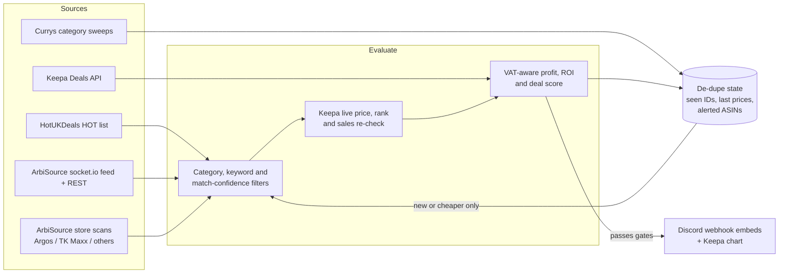

# Deal Monitors

Python services that watch UK deal sites and sourcing feeds, work out VAT-aware profit against Amazon marketplace prices and post only the deals worth buying to Discord.

Built for **GA Goods**, an e-commerce distribution business.

## Why I built it

Finding profitable stock by hand means refreshing deal sites, copying barcodes into Keepa and doing the fee maths on a calculator, deal by deal. Most of it turns out to be unprofitable. I wanted to find profitable stock for an e-commerce distribution business faster than I could by hand: let the code watch the sources around the clock, do the maths the same way every time and only interrupt me with something worth acting on.

## Monitors and features

| Module | What it does |
| --- | --- |
| `hukd_monitor.py` | Reads the HotUKDeals HOT list every ~5 minutes and posts each deal once, as it turns hot, with price, shop, voucher code and heat. Filters out food, clothing, used/refurbished, digital, travel and services. |
| `arbisource_monitor.py` | Listens to ArbiSource's socket.io price-drop feed, fetches the newest drops over REST, scores them with its own filter and posts the winners. |
| `arbisource_scanner.py` / `arbisource_results.py` | Starts scheduled ArbiSource store scans (ArbiSource has no scheduling of its own) then scores the completed scan results with the same filter. |
| `argos_monitor.py` | Argos to Amazon flips, fed by full ArbiSource store scans every few hours plus the price-drop feed in between, re-checked against live Keepa data with the Keepa price chart attached. |
| `tkmaxx_monitor.py` | The same pipeline pointed at TK Maxx, relying on a title/image match confidence floor because TK Maxx products have no EAN matching. |
| `currys_monitor.py` | Sweeps every configured Currys category, records each price and spends Keepa tokens only on products whose price actually dropped since the last sweep. |
| `a2a_finder.py` | Polls Keepa's Deals API for Amazon price drops and alerts when buying at the dropped price and reselling at the 90-day average is profitable, with a rendered price-history chart. |
| `main.py` / `run_category.py` | The original multi-site pipeline: scrape supplier category pages, match to Amazon by EAN (or title plus image similarity), price with Keepa, alert on ROI. Runs every 4 hours under APScheduler. |
| `arbisource_filter.py` | The shared quality filter and 0-100 deal score used by every ArbiSource-fed monitor. |
| `calculator.py` | Fee, profit and ROI maths, VAT-registered or not. |
| `keepa_client.py` | Keepa lookups by EAN or ASIN in batches, price-history parsing, monthly sales estimates from rank drops. |
| `discord_notifier.py` / `image_match.py` | Discord embed builder and perceptual-hash image comparison for title-only matches. |
| Diagnostics | `check_product.py`, `diagnose_keepa.py`, `debug_scraper.py`, `count_currys_totals.py`, `discover_currys_categories.py` and the `test_*.py` scripts for checking one product, one category or one stage of the pipeline. |

## The profit maths

All monitors work from the same idea: profit has to hold up after every Amazon fee and after VAT.

- **Fees:** referral fee (flat or tiered per category, worked on the inc-VAT selling price), fulfilment fee from Keepa, the digital services fee as a percentage of those two fees and a per-unit prep cost.
- **VAT-registered profit:** when `vat_registered` is on, both the selling price and the supplier price are taken ex-VAT (VAT is passed through rather than kept), so
  `profit = sell / 1.2 - buy / 1.2 - fulfilment - referral - digital services - prep`.
- **ROI:** profit divided by the cash actually paid out, inc VAT: `roi = profit / buy price x 100`.
- **Selling price:** the ArbiSource filter judges every deal at the **90-day average** selling price, not the spot price, rejects listings whose current price is a spike above that average or whose 30-day average is falling away from it and requires enough 30-day sales-rank drops to show the item actually sells. A deal must also clear a smaller profit floor at today's price.
- For the Argos and TK Maxx monitors, ArbiSource's own VAT-registered profit figure is used as-is and ROI is that profit over the price paid inc VAT.

## Architecture



## Tech stack

- **Python 3.10+**
- **Playwright** (Chromium, persistent profiles) and **BeautifulSoup/lxml** for scraping
- **requests**, **curl_cffi** and **python-socketio** for HTTP and the ArbiSource socket feed
- **Keepa API** (via the `keepa` package and direct REST calls) for Amazon price, rank and sales history
- **ArbiSource API** for store scans and price drops
- **Discord webhooks** for alerts
- **APScheduler**, **PyYAML**, **python-dotenv**
- **Pillow + imagehash** for perceptual image matching, **matplotlib** for price charts

## Engineering highlights

- **Durable de-duplication.** Every monitor keeps its own state file (seen deal IDs, last-seen prices, alerted ASINs) written atomically via a temp file and `os.replace`, capped or expired so it never grows without bound. A first run seeds silently so a restart never floods the channel with old deals, and the Argos/TK Maxx monitors only re-alert an ASIN if it gets meaningfully cheaper or the last alert is old.
- **Socket feed handling.** The ArbiSource socket event carries only a count, so events are treated as nudges: bursts are debounced, REST fetches are rate-limited to one a minute, a safety poll runs if the socket goes quiet and the subscription is re-sent every 5 minutes with automatic reconnection.
- **Keepa token budgeting.** The Currys monitor diffs prices between sweeps and only spends Keepa tokens on real price drops, turning ~1,440 lookups per sweep into dozens, and it spends tokens as they accrue so the 60-token bucket never overflows and wastes refills.
- **Rate limits and retries.** Discord `429` responses are honoured using `retry_after`, posts per batch are capped so a burst cannot flood a channel, ArbiSource re-authenticates automatically on `401`/`403` and refreshes its JWT well before expiry.
- **Service-style running on Windows.** Long-running monitors have a `--service` mode for a startup shortcut under `pythonw`: a localhost port acts as a single-instance lock, config is re-read each cycle so settings change without a restart and a crash is logged then restarted after 60 seconds.
- **Sceptical matching.** EAN flags are not trusted blindly: alerts show what the match rests on (EAN, model codes, title similarity), suspiciously large discounts are flagged as likely mis-scrapes and title-only matches can be checked with perceptual image hashing.

## Screenshots

Screenshots of the Discord alerts live in [`docs/screenshots/`](docs/screenshots/).

## Setup

```bash
git clone <this repo>
cd deal-monitors
python -m venv .venv
.venv\Scripts\activate          # Windows (source .venv/bin/activate elsewhere)
pip install -r requirements.txt
playwright install chromium

copy .env.example .env           # then fill in your keys and webhooks
copy config.example.yaml config.yaml
```

Secrets (Keepa and ArbiSource keys, Discord webhooks, proxy credentials) are read from `.env`. Thresholds, categories and filters live in `config.yaml`.

Run any monitor directly, for example:

```bash
python hukd_monitor.py --dry-run      # list recent deals, post nothing
python arbisource_monitor.py --backfill --dry-run
python currys_monitor.py --once
python argos_monitor.py --service     # background mode
```


## Project structure

```
deal-monitors/
├── hukd_monitor.py            # HotUKDeals HOT-deal feed
├── arbisource_client.py       # ArbiSource REST client (JWT auth)
├── arbisource_filter.py       # shared quality filter + deal score
├── arbisource_monitor.py      # socket.io price-drop monitor
├── arbisource_scanner.py      # scheduled store scans
├── arbisource_results.py      # score completed scan results
├── argos_monitor.py           # Argos -> Amazon flips via ArbiSource
├── tkmaxx_monitor.py          # TK Maxx -> Amazon flips via ArbiSource
├── currys_monitor.py          # Currys sweep, Keepa on price drops only
├── a2a_finder.py              # Keepa Deals API price-drop finder
├── main.py / run_category.py  # original scrape -> Keepa -> ROI pipeline
├── scraper.py                 # Playwright category/product scraper
├── keepa_client.py            # Keepa lookups and sales estimates
├── calculator.py              # fees, VAT-aware profit, ROI
├── discord_notifier.py        # Discord embeds
├── image_match.py             # perceptual-hash image matching
├── config_loader.py           # config.yaml + .env secrets
├── check_product.py, diagnose_keepa.py, debug_scraper.py,
│   count_currys_totals.py, discover_currys_categories.py, test_*.py
├── config.example.yaml
├── .env.example
├── requirements.txt
├── docs/screenshots/
└── LICENSE
```

## Responsible use

This is a personal tool for one small business. It reads publicly visible deal listings and data from services I subscribe to, keeps request rates low (fixed intervals with jitter, request delays, capped batches) and honours rate-limit responses. It does not resell or republish anyone's data. If you adapt it, check each site's terms first and keep the volume modest.

## Licence

MIT. See [LICENSE](LICENSE).
